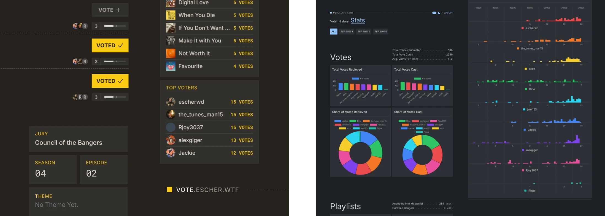

<p align="center">


</p>

## About This Project

**masterlist-vote-site** is a [Laravel](https://laravel.com/) web app for facilitating music discovery clubs. The web app syncs with Spotify to automatically sync tracks from a "submissions" playlist, creating a filtered "master list" playlist of majority-approved tracks. It works like this:

1. Members of the club contribute tracks to shared Spotify playlist, known as the "submissions" playlist.
2. Once all tracks are submitted, members use the site to vote for the songs they liked the most. Tracks are automatically synced from the submissions playlist via the Spotify API.
3. Once all votes have been cast, tracks that reached the group-defined vote threshold will automatically be added to the "master list". 
    - A track that receives a vote from _every member_ is known as a **certified banger**, and additionally gets added to a separate playlist.

Voting sessions are organized into _seasons_ and _episodes_. A separate "master list" playlist is created for each season. In addition to providing a platform for automatically managing voting, this web app also serves to visualize voting trends (see below).

> ⚠️ Following [this change](https://developer.spotify.com/blog/2026-02-06-update-on-developer-access-and-platform-security) to the Spotify API, this project will no longer work without a subscription to a premium Spotify account. Support for Spotify is likely to be abandoned in favor of Deezer in the near future.

## Screenshots



## Running

To run this project, clone this repo and fetch the dependencies using [Composer](https://getcomposer.org/).

```bash
composer install
```

Next, use [Laravel Artisan](https://laravel.com/docs/13.x/artisan) to migrate and seed the database.

```bash
php artisan migrate --fresh
php artisan db:seed
```

Finally, run the project

```bash
php artisan serve
```

## Road Map

- Update to Laravel 13
- Support for other streaming services
    - Deezer
    - Tidal
    - Apple Music
- Support for multiple voting groups


## License

This project is open-sourced software licensed under the [MIT license](https://opensource.org/licenses/MIT).